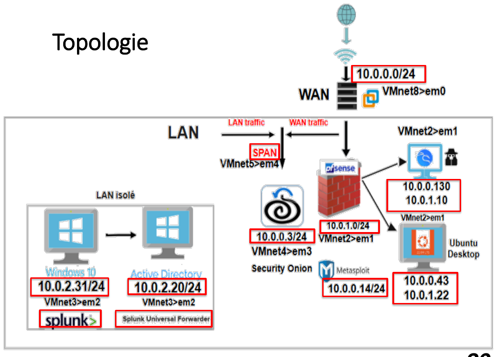
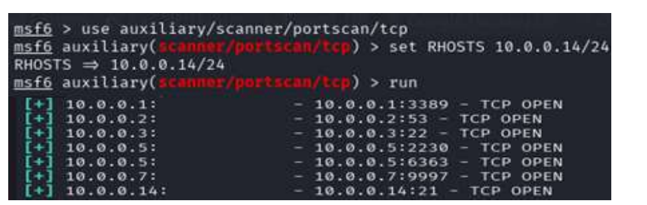
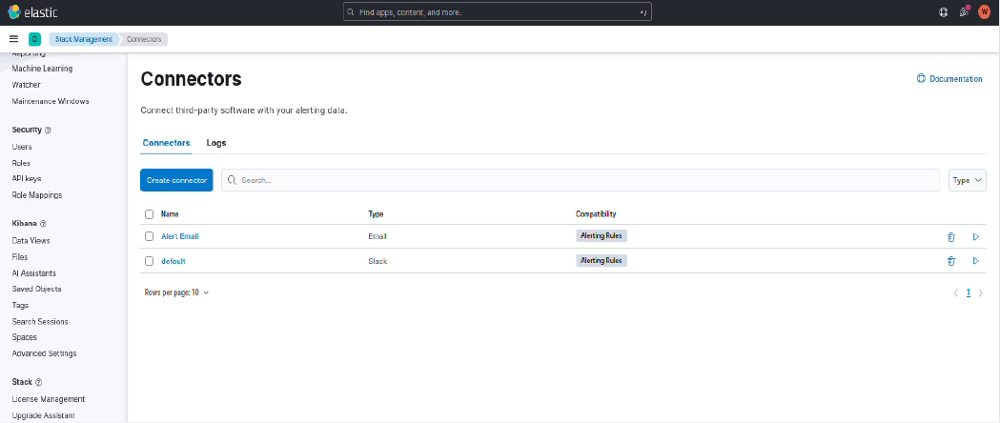
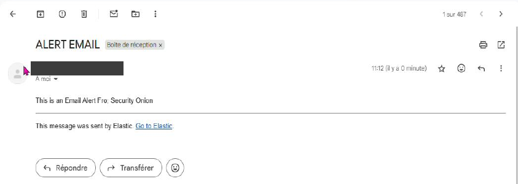
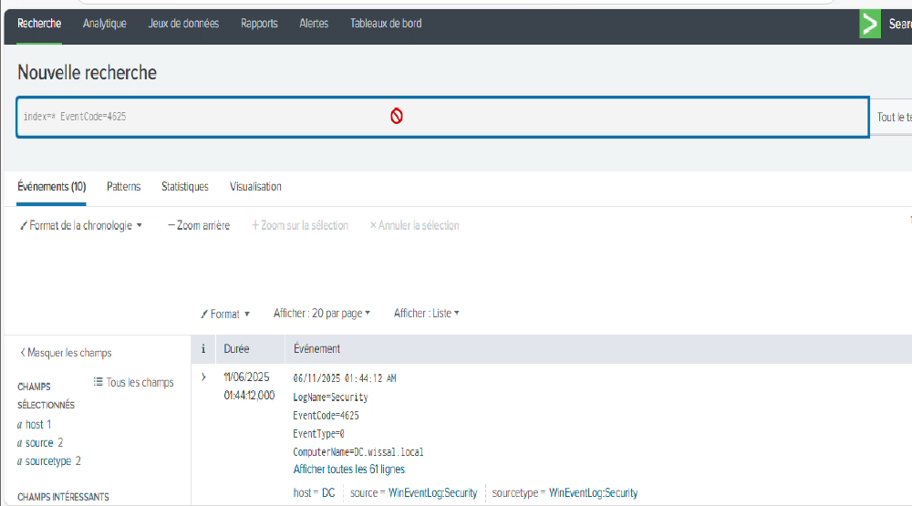

# SIEM pour PME : Security Onion et Splunk (laboratoire)

Projet de fin d'études, ISET Tozeur (2024/2025) : conception et test, en laboratoire virtuel, d'une solution de détection d'intrusions accessible à une PME.

## Problème

Les PME sont des cibles fréquentes de cyberattaques, mais disposent rarement du budget, du temps ou des experts nécessaires pour surveiller leur réseau. Les journaux s'accumulent, personne ne les lit, et une intrusion peut passer inaperçue.

## Solution

Un laboratoire virtuel qui simule un réseau d'entreprise, supervisé par deux SIEM :

- **Security Onion** (open source) : analyse du trafic réseau avec Suricata, Zeek et la pile Elastic.
- **Splunk Enterprise** (version gratuite) : collecte et analyse des journaux Windows d'un domaine Active Directory.

Des attaques contrôlées sont lancées depuis Kali Linux pour vérifier que les outils les détectent et envoient des alertes.

## Architecture

| Élément | Rôle |
|---|---|
| **pfSense** | Pare-feu et routeur entre le WAN et le LAN |
| **Port SPAN** | Copie du trafic réseau vers Security Onion |
| **Security Onion 2.4** (installation Eval) | Détection d'intrusions et supervision réseau |
| **Kali Linux** | Machine attaquante |
| **Metasploitable 2** | Cible volontairement vulnérable |
| **Ubuntu Desktop 22.04** | Poste d'administration et de consultation |
| **Windows Server (Active Directory)** | Contrôleur de domaine supervisé |
| **Windows 10** | Poste client du domaine |
| **Splunk Universal Forwarder** | Envoi des journaux Windows vers Splunk |

Le tout fonctionne sous **VMware Workstation**, avec un réseau isolé (`vmnet3`) pour le domaine Windows.

## Scénarios testés

| Scénario | Outils | Supervision |
|---|---|---|
| Scan de ports TCP | Metasploit (`auxiliary/scanner/portscan/tcp`), Nmap | Security Onion |
| Brute force SSH | Kali Linux, Medusa, `rockyou.txt` | Security Onion |
| Import de fichiers PCAP | `so-import-pcap` | Security Onion |
| Brute force sur Active Directory (échecs de connexion, `EventCode=4625`) | Kali Linux | Splunk |

## Résultats

### Scan de ports et alertes Suricata

Un scan TCP lancé avec Metasploit sur le réseau `10.0.0.0/24` identifie plusieurs services ouverts.

Des alertes Suricata remontent dans la page **Alerts** de Security Onion.

### Notifications d'alerte

Security Onion (via Elastic) est configuré avec deux connecteurs : un e-mail et un canal Slack.

Un e-mail de test est bien reçu.

### Détection d'un brute force sur Active Directory

Les journaux de sécurité du contrôleur de domaine sont envoyés à Splunk. Une recherche sur `EventCode=4625` (échec d'ouverture de session) permet de repérer les tentatives répétées.

## Comparaison des deux solutions

| | Security Onion | Splunk |
|---|---|---|
| **Licence** | Open source | Commercial (version gratuite limitée) |
| **Point fort** | Analyse du trafic réseau et détection d'intrusions | Analyse et visualisation des journaux |
| **Source de données** | Trafic réseau (port SPAN) | Journaux Windows (forwarder) |
| **Adapté à** | Surveillance réseau avec un budget limité | Corrélation de journaux et tableaux de bord |

## Technologies

Security Onion 2.4, Suricata, Zeek, Elastic Stack / Kibana, Splunk Enterprise 9.4, pfSense, Kali Linux, Metasploit, Medusa, Nmap, Metasploitable 2, Active Directory, Windows Server, Windows 10, Ubuntu 22.04, VMware Workstation.

## Mon rôle

Projet réalisé seule, sous l'encadrement de M. Haithem Hafsi :

- conception de l'architecture réseau et du plan d'adressage ;
- installation et configuration de tous les outils ;
- simulation des attaques et analyse des alertes ;
- configuration des notifications (e-mail et Slack) ;
- comparaison des solutions SIEM.

## Limites

- Projet réalisé **en laboratoire** : aucun réseau d'entreprise réel n'a été supervisé.
- Les tests portent sur quelques scénarios d'attaque courants, pas sur un jeu de règles de détection complet.
- Security Onion demande des ressources importantes (RAM, CPU) : un déploiement réel doit être dimensionné en conséquence.

## Avertissement

Toutes les attaques ont été réalisées **uniquement sur mes propres machines virtuelles**, dans un réseau isolé. Ne reproduisez jamais ces techniques sur un système sans l'autorisation écrite de son propriétaire.

## Contexte

Mémoire de fin d'études, Institut Supérieur des Études Technologiques de Tozeur, année universitaire 2024/2025.

**Auteure :** Wissal Elkouk
**Encadrant :** Haithem Hafsi
